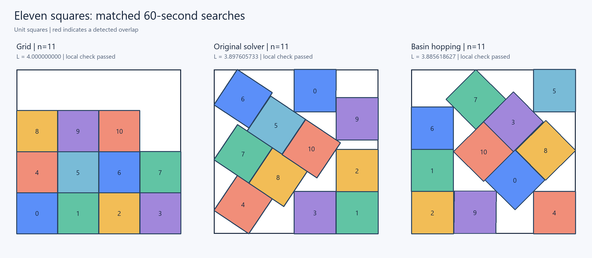

# Basin hopping: first eleven-square results

Run date: 2026-10-25.
Each method received 60 seconds per seed. Development seeds 0 and 1
were separate from comparison seeds 20, 21, and 22.

| Seed | Original solver L | Basin hopping L | Hops |
| --- | --- | --- | --- |
| 20 | 3.897605733 | 3.886746573 | 68 |
| 21 | 4.000000000 | 3.914214113 | 71 |
| 22 | 4.000000000 | 3.885618627 | 106 |

| Method | Best L | Median L | Improved runs |
| --- | --- | --- | --- |
| legacy | 3.897605733 | 4.000000000 | 1/3 |
| basin | 3.885618627 | 3.886746573 | 3/3 |

All six exported benchmark packings passed the downloaded official
metric notebook's original feasibility functions. No reference layout
was supplied to either solver.

The original solver improved on the grid with some of these seeds.
Its earlier failure on seeds 0, 1, and 2 was not a general inability to
solve eleven squares.

This is a comparison of complete pipelines: basin hopping includes
analytic derivatives, whereas the original solver uses finite differences.
The sample is small; it does not isolate the benefit of hopping from
the benefit of faster local refinement.

Selected n=11 incumbent: **L=3.885618627100**, from runs\basin-benchmark-001\best-basin.csv.
The updated full submission has estimated score **28.679576010528**
and contains all 1,000 puzzles (500,500 rows).
The prior full submission scored approximately 28.714063292065.

Files:

- submissions/optimized-002.csv: updated full incumbent
- submissions/improved-puzzles-002.csv: replacement puzzles checked with the official metric
- runs/optimized-002-report.json: full local readback/validation and replacement certification
- runs/basin-benchmark-001/: parameters, source snapshots, per-hop histories, and seed outputs

The full CSV was validated locally. The official metric was run on
replaced puzzles; the rest remain exact grid packings. Nothing was
submitted to Kaggle.

The comparison initially stopped after its first pair because the
progress writer used exclusive file creation. Completed results were
reused after correcting the writer and adding resume support; solver
source hashes were verified unchanged. A regression test now covers
multiple progress updates and resuming completed runs.

Eight new tests and fourteen prior regression tests passed. Existing
test-file deletions were preserved; prior tests ran from a scratch copy.

See [the method guide](basin-hopping.md) and
[machine-readable results](basin-results.json).
