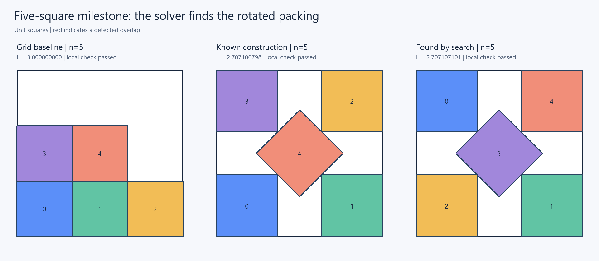

# First optimization results

Run date: 2026-10-24. These are local results, not a Kaggle submission.

The blind solver starts from grids and randomized configurations. The known
five-square construction is kept separate from all solver starts.

| n | Grid L | Best search L | Improved seeds | Median solver seconds |
| --- | --- | --- | --- | --- |
| 5 | 3 | 2.707107101 | 3/3 | 23.53 |
| 10 | 4 | 3.707107305 | 2/3 | 59.48 |
| 11 | 4 | 4.000000000 | 0/3 | 95.97 |

The n=5 search reached within 1e-5 of the known optimum in 2/3 seeds.
All nine exported benchmark packings passed the downloaded official
notebook's original feasibility functions. Timings exclude metric checks.

Full incumbent score estimate: **28.714063292065**, compared with
**28.937669916551** for the grid baseline.

The final incumbent uses the analytical five-square reference if it is
tighter than the search result, plus the best certified search results
for the other cases. That replacement does not change the blind benchmark.

Local artifacts:

- runs/benchmark-001/: settings, source snapshots, seed histories, CSVs, official reports, diagrams
- submissions/improved-puzzles-001.csv: replacement puzzles checked with the official notebook
- submissions/optimized-001.csv: full 1,000-puzzle, 500,500-row incumbent
- runs/optimized-001-report.json: full local validation plus official checks of replacements

The unchanged grid puzzles use exact half-integer centers and zero rotations.
The entire full CSV was read back and validated locally; official notebook
checks were run on replaced puzzles, not all 1,000 grid puzzles again.

Validation: 14 unit tests passed; a perfect-square area-bound control
passed the official check, and an intentionally overlapping packing was rejected.

## Next experiment

The first solver is sensitive to starts. Prioritize contact rearrangements
and starts derived from neighboring puzzle solutions, especially for n=11.
Keep the current certified incumbent while testing those changes.

See [the optimization guide](optimization.md) for reproduction commands
and [the machine-readable results](first-results.json) for provenance.
